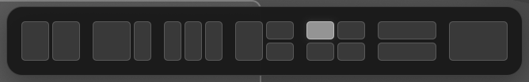

# Tidy

[한국어](README.md) · [English](docs/README.en.md)

Window tiling for GNOME

창을 화면 위로 끌어 배치를 고르고, 단축키로 모니터 사이를 이동하세요.
Windows의 Snap Layouts와 macOS의 Magnet에서 익숙한 창 배치를 Ubuntu GNOME에서 사용할 수 있습니다.


[](https://www.npmjs.com/package/@hnode/tidy)
[](LICENSE)

[Install](#install) · [Features](#features) · [Quick Start](#quick-start) · [Shortcuts](#shortcuts) · [Uninstall](#uninstall)

## Overview

Tidy는 GNOME Shell에서 실행되는 창 배치 확장입니다. 여러 모니터를 사용할 때도 화면 상단 안쪽에서 배치 선택기를 열고, 그림으로 표시된 칸에 창을 놓을 수 있습니다.



설정 화면과 메뉴는 시스템 언어를 따릅니다. 한국어와 영어를 지원하며, 그 외 언어에서는 영어로 표시합니다.

## Features

| 기능 | 동작 |
| --- | --- |
| 상단 배치 선택기 | 창을 상단 중앙으로 끌어 원하는 칸에 놓습니다. 7가지 레이아웃을 제공합니다. |
| 가장자리 배치 | 중앙 외 상단은 최대화, 왼쪽·오른쪽 가장자리는 절반 배치로 동작합니다. |
| 창·앱 보기 연동 | Super로 기존 창·앱 보기와 선택기를 함께 열고, 창 미리보기를 배치 칸에 끌어 놓습니다. |
| 사용자 지정 단축키 | Super+Alt 조합으로 절반·¼·⅓·⅔ 배치를 지정하고 단축키를 바꿀 수 있습니다. |
| 다중 모니터 | 같은 방향키를 반복하면 해당 방향의 모니터로 이동합니다. 선택기 크기도 모니터에 맞춰 조절합니다. |
| 함께 크기 조절 | 타일 창의 공유 경계를 끌면 맞닿은 창을 함께 조절합니다. 기본값은 켬입니다. |
| 남은 공간 채우기 | 빈 영역에 실행 중인 앱 아이콘을 표시해 다음 창을 고릅니다. 기본값은 끔입니다. |
| 크기와 간격 설정 | 일반 선택기와 창·앱 보기 선택기의 크기, 창 사이 간격을 조절합니다. |

## Platform Support

| 환경 | 상태 |
| --- | --- |
| Ubuntu 26.04 · GNOME 50.1 · Wayland | 독립 GNOME 세션의 실제 Wayland 창과 가상 모니터 2개로 검증 |
| GNOME 46–49 | 호환 버전으로 선언되어 있으나 실기 검증 전 |
| X11 | 실기 검증 전 |
| KDE · Xfce · Windows · macOS | 지원 대상 아님 |

실행에는 시스템 Python 3와 PyGObject, GJS, GTK 4/libadwaita가 필요합니다. npm 명령에는 Node.js 18 이상이 필요하며, 소스에서 직접 빌드할 때는 `glib-compile-schemas`도 필요합니다. 설치된 GNOME 확장은 Node.js나 npm 프로세스를 띄우지 않습니다.

## Install

### npm

패키지 이름은 **`@hnode/tidy`**, 실행 명령은 **`tidy`**입니다. npm 공개 후 다음 명령으로 패키지와 GNOME 확장을 설치합니다.

```bash
npm install -g @hnode/tidy
tidy install
```

전역 설치 없이 한 번의 명령으로 설치할 수도 있습니다.

```bash
npx @hnode/tidy@latest install
```

`tidy doctor`로 시스템 요구 사항을 확인하고, `tidy --help`로 명령 목록을 볼 수 있습니다. `tidy install`은 sudo 없이 현재 GNOME 사용자로 실행하세요. npm 패키지 설치만으로 데스크톱 설정이 바뀌지는 않습니다.

**처음 설치하고 다시 로그인하면 자동으로 동작합니다. 매번 터미널에서 실행할 필요가 없습니다.** 설정은 앱 목록의 **Tidy**나 상단 격자 아이콘에서 열 수 있습니다.

### Source

저장소를 내려받아 직접 설치할 수도 있습니다.

```bash
git clone https://github.com/hojin-v/Tidy.git
cd Tidy
/usr/bin/python3 scripts/manage.py install
```

Git 대신 [Download ZIP](https://github.com/hojin-v/Tidy/archive/refs/heads/main.zip)으로 받아 압축을 푼 폴더에서 마지막 명령을 실행해도 됩니다. 설치는 사용자 계정으로 진행합니다.

**최초 설치 후 로그아웃하고 다시 로그인하면 자동 활성화됩니다.** 이후 앱 목록의 **Tidy** 또는 상단 패널의 격자 아이콘에서 설정을 엽니다.

설치에 필요한 도구도 설치 위치에 복사합니다. **설치가 완료되면 다운로드한 ZIP과 소스 폴더, npm 캐시를 삭제해도 됩니다.** 첫 재로그인 전에 원본 폴더를 삭제해도 자동 적용됩니다.

## Quick Start

1. 창의 제목 표시줄을 잡으면 상단에 선택기 인식 영역이 얇게 나타납니다.
2. 그 영역으로 끌면 선택기가 펼쳐지고 창이 작은 미리보기로 줄어듭니다. 원하는 배치 칸으로 포인터를 옮깁니다.
3. 마우스를 놓으면 창을 배치합니다. 빈 곳에서 놓으면 취소합니다.

**Super**를 누르면 기존 창·앱 보기와 배치 선택기가 함께 열립니다. 창 미리보기를 원하는 칸에 끌어 놓거나, 칸을 클릭해 원래 포커스된 창을 배치할 수 있습니다. 검색은 글자를 입력할 때 나타납니다.

창·앱 보기에서는 창 미리보기와 앱 아이콘을 잡고 움직이는 즉시 작아지며, 놓거나 취소하면 원래 크기로 돌아옵니다. 선택기 표시를 꺼도 이 모션은 동작합니다. 배치 칸에 놓으면 작은 미리보기에서 배치 위치로 이어집니다.

남은 공간의 창 선택 옵션을 켰다면 빈 영역의 앱 아이콘을 선택하세요. 현재 창이나 다른 영역을 클릭하거나 Esc를 누르면 추가 배치 없이 마칩니다.

선택기는 Ubuntu Dock의 애니메이션 시간과 곡선을 따라 상단에서 미끄러져 나옵니다. 선택 영역을 벗어나면 창이 원래 크기로 돌아오며, 놓으면 작은 미리보기에서 배치 위치로 이어집니다.

배치 미리보기는 선택기와 같은 차콜·회색 톤의 은은한 테두리와 옅은 반투명 음영, 부드러운 그림자로 표시합니다. 좌우·상단 가장자리에서도 같은 영역에 머무르는 동안 안정적으로 유지됩니다.

## Shortcuts

배치 단축키는 **Super+Alt** 조합으로 통일되어 있습니다. 설정의 **단축키** 탭에서 바꿀 수 있습니다.

| 단축키 | 동작 |
| --- | --- |
| Super | 기존 창·앱 보기와 배치 선택기 열기 / 닫기 |
| Super + A | GNOME 앱 목록 전환 |
| Super + Alt + ← / → | 왼쪽 / 오른쪽 절반 배치. 같은 방향 반복 시 다음 모니터로 이동하며 양 끝에서는 반대편 끝으로 순환 |
| Super + Alt + ↑ / ↓ | 위쪽 / 아래쪽 절반 배치. 같은 방향 반복 시 위·아래 모니터로 이동하며 양 끝에서는 반대편 끝으로 순환 |
| Super + Alt + Enter | 최대화 / 이전 크기·배치로 복귀 |
| Super + Alt + U / I / J / K | 왼쪽 위 / 오른쪽 위 / 왼쪽 아래 / 오른쪽 아래 ¼ |
| Super + Alt + D / F / G | 왼쪽 / 가운데 / 오른쪽 ⅓ |
| Super + Alt + E / T | 왼쪽 / 오른쪽 ⅔ |
| Super + Alt + C | 가운데 ¾ 크기 |
| Super + Alt + Space | 배치 선택기 열기 |
| Super + Alt + N | 다음 모니터로 이동 |

가장 왼쪽 모니터의 왼쪽 절반에서 **Super+Alt+←**를 누르면 가장 오른쪽 모니터의 오른쪽 절반으로 이동합니다. 가장 오른쪽의 오른쪽 절반에서 **Super+Alt+→**를 누르면 가장 왼쪽의 왼쪽 절반으로 이동합니다. 순환할 때는 창이 가장자리로 나갔다가 반대쪽에서 들어오는 모션을 사용합니다. 모니터가 하나면 순환하지 않습니다.

위쪽 절반에서 **Super+Alt+↑**를 한 번 더 누르면 위 모니터의 아래쪽 절반으로 이동하고, 아래쪽 절반에서 **Super+Alt+↓**를 한 번 더 누르면 아래 모니터의 위쪽 절반으로 이동합니다. 맨 위·맨 아래에서도 반대편 끝으로 순환합니다.

## Settings

앱 목록의 **Tidy** 또는 **상단 격자 아이콘 → 설정 및 단축키…**에서 변경합니다. 설정은 즉시 반영됩니다.

- **기존 Super+방향키 창 배치 끄기**: GNOME 기본 배치 단축키를 끕니다. 해제하거나 Tidy를 종료하면 기존 단축키를 복원합니다.
- **모니터에 맞춰 선택기 크기 자동 조절**: 내장 화면을 기준으로 큰 외장 모니터의 선택기를 적당히 키웁니다. 기본값은 켬입니다.
- **배치 선택기 크기 / 창·앱 보기 선택기 크기**: 기본 크기는 같으며, 창·앱 보기의 크기를 별도로 조절할 수 있습니다.
- **선택기 너비에 인식 범위 맞추기**: 기본값은 켬입니다. 모니터별 선택기 너비에 맞춰 인식 영역과 드래그 안내를 조절합니다. 끄면 기존 사용자 지정 너비를 사용합니다.
- **남은 공간의 창 선택**: 배치 후 빈 영역에 앱 아이콘을 표시합니다. 기본값은 끔입니다.

CLI에서도 설정이나 상태를 확인할 수 있습니다.

```bash
tidy prefs
tidy status
```

CLI 없이 설치된 관리 도구를 직접 실행할 수도 있습니다. 원본 소스 폴더는 필요하지 않습니다.

```bash
tidy_manager="${XDG_DATA_HOME:-$HOME/.local/share}/gnome-shell/extensions/winubun@winubun.local/scripts/manage.py"
/usr/bin/python3 "$tidy_manager" prefs
/usr/bin/python3 "$tidy_manager" status
```

## Update

npm 패키지를 갱신한 뒤 확장에 적용합니다. `tidy update`는 현재 설치된 npm 패키지 버전을 적용합니다.

```bash
npm install -g @hnode/tidy@latest
tidy update
```

전역 설치를 사용하지 않았다면 `npx @hnode/tidy@latest install`을 다시 실행하세요. 소스 설치는 새 소스를 받아 설치 명령을 다시 실행합니다.

```bash
git pull --ff-only
/usr/bin/python3 scripts/manage.py install
```

확장 코드의 버전이 바뀌면 로그아웃 후 다시 로그인하세요. GNOME은 로그인 중 불러온 JavaScript를 캐시하므로 확장을 껐다 켜는 것만으로는 새 코드가 적용되지 않습니다. 기존 설정과 단축키는 유지합니다.

## Uninstall

확장을 먼저 제거하고 npm CLI를 제거합니다.

```bash
tidy uninstall
npm uninstall -g @hnode/tidy
```

npx로 설치했다면 `npx @hnode/tidy@latest uninstall`을 사용하세요. **npm 패키지만 제거해도 GNOME 확장은 계속 설치된 상태로 남습니다.**

CLI가 없어도 어느 폴더에서든 설치된 도구로 제거할 수 있습니다.

```bash
/usr/bin/python3 "${XDG_DATA_HOME:-$HOME/.local/share}/gnome-shell/extensions/winubun@winubun.local/scripts/manage.py" uninstall
```

확장과 앱 실행기를 제거하고, 변경했던 GNOME 설정과 기존 타일링 확장 상태를 복원합니다. Tidy의 사용자 설정과 단축키는 재설치를 위해 보관합니다.

경로의 `winubun`은 기존 설정과 고정한 실행기의 호환성을 위해 유지한 내부 이름입니다.

## Notes

- **Ubuntu Tiling Assistant**가 켜져 있으면 설치 도구가 원래 상태를 기록하고 비활성화합니다. `uninstall` 시 복원합니다. 확장 앱에서 Tidy만 끄면 Tiling Assistant는 중지 상태로 남습니다.
- 앱이 요구하는 최소 창 크기나 터미널의 크기 단위 때문에 작은 칸에 정확히 맞지 않을 수 있습니다. 전체 화면 앱과 이동·크기 변경을 허용하지 않는 창은 배치 대상에서 제외합니다.
- 문제를 신고할 때는 GNOME 버전, Wayland/X11 여부, 모니터 배치와 재현 순서를 [Issues](https://github.com/hojin-v/Tidy/issues)에 남겨 주세요.

개발 명령, 테스트 범위와 진단 경로는 [Development](docs/DEVELOPMENT.md), npm 게시 절차는 [Releasing](docs/RELEASING.md)에서 확인할 수 있습니다.

## License

Copyright © 2026 hojin-v. **GNU GPL v3.0 or later**로 배포합니다.

라이선스 전문은 [LICENSE](LICENSE), 프로젝트 고지는 [NOTICE](NOTICE)를 참고하세요.
