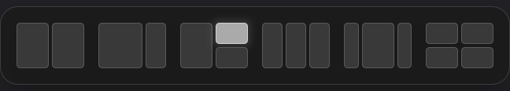

# Tidy

[한국어](../README.md) · [English](README.en.md)

Window tiling for GNOME and macOS

Drag a window to the top of a monitor, choose a layout, and move between monitors with keyboard shortcuts.
Tidy arranges windows with a GNOME extension or a macOS desktop app.


[](https://www.npmjs.com/package/@hnode/tidy)
[](../LICENSE)

[Install](#install) · [Features](#features) · [Quick Start](#quick-start) · [Shortcuts](#shortcuts) · [Uninstall](#uninstall)

## Overview

Tidy runs as a GNOME Shell extension on Ubuntu and as a separate desktop app on macOS. Its layout picker opens inside the top-center area of each monitor, making it easier to use across multiple displays.



The interface follows your desktop language. Korean and English are supported; other languages fall back to English.

## Features

The table below describes the GNOME edition. macOS provides the six-layout picker, top dragging and edge snapping, custom shortcuts, multiple monitors, maximize/restore and window gaps. GNOME overview integration, maximize-button hover, miniature animations, linked resizing and snap assist remain GNOME features.

| Feature | Behavior |
| --- | --- |
| Top layout picker | Drop a window into one of six layouts arranged in a single row. |
| Maximize button picker | Hover over maximize or restore to open a three-column, two-row picker below the button. Can be disabled in settings. |
| Edge snapping | Other top edges maximize; left and right edges tile halves. |
| Overview integration | Press Super to open window overview and the single-row picker together. The picker is hidden in the Super+A application grid. |
| Custom shortcuts | Use Super+Alt for halves, quarters, thirds and two-thirds; customize the bindings in settings. |
| Multiple monitors | Repeat an arrow shortcut to move to the monitor in that direction, including above and below. Picker size adapts to each monitor. |
| Linked resizing | Drag shared boundaries to resize adjacent tiled windows together. Enabled by default. |
| Optional snap assist | Choose live window previews with titles inside empty regions. Multiple windows of the same app appear separately. Disabled by default. |
| Size and spacing | Adjust picker sizes and window gaps, including a separate overview picker size. |

The 100% picker size now matches the previous 115% size. Saved sizes are converted to the new reference. Top/bottom and maximize cards are removed, and a **¼ · ½ · ¼** layout sits immediately to the right of equal thirds. Maximize shortcuts and top-edge maximization remain available. Automatic sizing preserves the 16-inch built-in reference; on a 32-inch external monitor, the new 100% matches approximately 80% of the previous automatic size.

The maximize button picker waits about 350 milliseconds before opening. Click a cell to arrange that window, move away or press Esc to dismiss. It uses actual accessibility button information and supports English and Korean maximize/restore labels, including Brave’s Korean restore control and nested titlebar containers; custom titlebars that do not expose these controls are skipped. The option defaults to on and is independent of top-edge dragging.

## Platform Support

| Environment | Status |
| --- | --- |
| Ubuntu 26.04 · GNOME 50.1 · Wayland | Tested with real Wayland windows and two virtual monitors in an isolated GNOME session |
| GNOME 46–49 | Declared compatible; not yet tested on those versions |
| X11 | Not yet tested |
| macOS 13+ · Intel/Apple Silicon | Desktop app using Accessibility added; real desktop testing pending |
| KDE · Xfce | Outside the supported platform |

GNOME runtime requirements: system Python 3 with PyGObject, GJS, and GTK 4/libadwaita. GNOME npm commands require Node.js 18 or later. Building compiled schemas requires `glib-compile-schemas`. The installed GNOME extension does not run a Node.js or npm process. macOS installation requires Node.js 22.12+, npm, the Swift compiler from Xcode Command Line Tools and Accessibility permission.

## Install

On macOS, use the same `tidy install` command, or `node bin/tidy.js install` from this repository. The desktop app downloads its Electron runtime, starts immediately and registers to run at login. Install Command Line Tools with `xcode-select --install` if needed, then allow Tidy under **System Settings → Privacy & Security → Accessibility** and restart it. Source files and npm caches can be deleted after installation. The logout/login and Python instructions below apply to GNOME.

macOS defaults to **Control+Option**, with the placement keys listed below. Open settings using `tidy prefs` or the menu bar icon. Settings include gaps, top dragging, edge snapping, login startup and editable shortcuts. `tidy update`, `tidy status` and `tidy uninstall` work on both supported platforms. Uninstalling removes the desktop app and login item while preserving settings. Native macOS tiling, system shortcuts and Mission Control are unchanged. The GNOME-specific settings below apply only to GNOME.

The shared logic, native protocol doubles, installation rollback and npm payload are tested on Ubuntu. Actual Mac window operations are not yet verified. CI is configured for Node tests and package builds on Ubuntu and macOS, plus Swift compilation and read-only protocol/UI probes on macOS. Full-screen and non-resizable windows are excluded. Minimum app sizes can limit exact placement.

Desktop data lives in `~/Library/Application Support/Tidy`. Settings are in `config/settings.json`; `status.json` contains permissions, shortcut conflicts and the latest error. See [macOS implementation notes (Korean)](MACOS.md) for more details.

### npm

The package is **`@hnode/tidy`** and the command is **`tidy`**. Once published to npm, install the package and register the GNOME extension:

```bash
npm install -g @hnode/tidy
tidy install
```

Or install without keeping a global npm package:

```bash
npx @hnode/tidy@latest install
```

Use `tidy doctor` to check system requirements and `tidy --help` to list commands. Run `tidy install` as your GNOME desktop user, without sudo. Installing the npm package alone does not change desktop settings.

**After the initial installation and logout/login, Tidy starts automatically. You do not need a terminal for daily use.** Open settings from **Tidy** in the app list or the top-panel grid icon.

### Source

You can also download the repository and install directly:

```bash
git clone https://github.com/hojin-v/Tidy.git
cd Tidy
/usr/bin/python3 scripts/manage.py install
```

Alternatively, use [Download ZIP](https://github.com/hojin-v/Tidy/archive/refs/heads/main.zip), extract it, and run the last command from that folder. Installation runs under your user account.

**Log out and back in after the first installation.** Tidy activates automatically. Open its settings from **Tidy** in the application list or the grid icon in the top panel.

All runtime tools are copied into the installation. **You can delete the downloaded ZIP, source folder and npm cache after installation succeeds**, even before the first logout/login.

## Quick Start

Super and overview integration below are GNOME features. On macOS, use the menu bar picker, the picker shortcut, or drag a window to the top center. Click a cell when opening the picker from a shortcut; use Tab/Enter or Esc for keyboard navigation.

1. Grab a window by its title bar. A thin hint appears at the top of the monitor.
2. Drag into that area to reveal the layouts and shrink the window into a small preview. Move the pointer onto the desired layout cell.
3. Release to tile the window. Release over empty space to cancel.

Press **Super** to open window overview and the single-row layout picker together. **Super+A** hides the picker and previews while the application grid is open; returning to window overview restores them. Drag a window preview into a cell, or click a cell to place the previously focused window. Search appears when you type.

Window previews shrink as soon as you start dragging in window overview, and return to their original size on release or cancellation. Dropping a window into a layout continues directly from the miniature to its final placement.

With snap assist enabled, select a live window preview in an empty region to tile that exact window there. Each window has its own preview and title, including multiple windows of the same app. Scroll within the region if there are many windows. Minimized windows are restored only when selected. Click the current window or another area, or press Esc, to finish without any additional placements.

The picker slides down using Ubuntu Dock's animation duration and curve. Leaving the selection area restores the window's size; dropping onto a cell animates directly from the miniature to its destination.

Placement previews share the picker's charcoal and gray theme, with a soft outline, subtle translucent fill and gentle shadow. They remain stable while you hold a window at a side or top edge.

## Shortcuts

Placement shortcuts consistently use **Super+Alt**. Change them in the **Shortcuts** tab.

| Shortcut | Action |
| --- | --- |
| Super | Open / close GNOME's overview and the layout picker |
| Super + A | Toggle GNOME's application grid |
| Super + Alt + ← / → | Tile to the left / right half; repeat to move in that direction, wrapping at the outer edges |
| Super + Alt + ↑ / ↓ | Tile to the top / bottom half; repeat to move above / below, wrapping at the outer edges |
| Super + Alt + Enter | Maximize / restore the previous size and placement |
| Super + Alt + U / I / J / K | Top-left / top-right / bottom-left / bottom-right quarter |
| Super + Alt + D / F / G | Left / center / right third |
| Super + Alt + E / T | Left / right two-thirds |
| Super + Alt + C | Centered three-quarter size |
| Super + Alt + Space | Open the layout picker |
| Super + Alt + N | Move to the next monitor |

From the left half of the leftmost monitor, **Super+Alt+←** wraps to the right half of the rightmost monitor. From the right half of the rightmost monitor, **Super+Alt+→** wraps to the left half of the leftmost monitor. The window slides out through one outer edge and enters through the opposite edge. A single monitor does not wrap.

From a top half, repeat **Super+Alt+↑** to enter the upper monitor's bottom half. From a bottom half, repeat **Super+Alt+↓** to enter the lower monitor's top half. At the topmost or bottommost edge, movement wraps to the opposite outer edge with the same sliding motion.

## Settings

Open **Tidy** from the application list, or choose **Settings and shortcuts…** from the top-panel grid icon. Changes take effect immediately.

- **Disable native Super+arrow tiling** disables GNOME's original tiling shortcuts. Turning it off or disabling Tidy restores them.
- **Adapt picker size to each monitor** keeps the built-in display as the baseline and gently enlarges the picker on larger external displays. Enabled by default.
- **Layout picker size / Overview picker size** default to equal sizes. The overview picker has its own relative size setting.
- **Match activation width to picker** keeps the activation area and drag hint aligned with the picker on each monitor. Enabled by default; turn it off to use your custom width.
- **Choose windows for the remaining space** shows live window previews and titles in empty layout regions. Disabled by default.

Open settings or check status from the CLI:

```bash
tidy prefs
tidy status
```

You can also use the installed management tool directly. The source folder is not needed:

```bash
tidy_manager="${XDG_DATA_HOME:-$HOME/.local/share}/gnome-shell/extensions/tidy@hnode/scripts/manage.py"
/usr/bin/python3 "$tidy_manager" prefs
/usr/bin/python3 "$tidy_manager" status
```

## Update

Update the npm package, then apply its extension version. `tidy update` installs the version bundled with the currently installed npm package:

```bash
npm install -g @hnode/tidy@latest
tidy update
```

For npx installations, rerun `npx @hnode/tidy@latest install`. For source installations, download the latest source and rerun the installer:

```bash
git pull --ff-only
/usr/bin/python3 scripts/manage.py install
```

Log out and back in when the extension code version changes. GNOME caches JavaScript for the session, so toggling the extension does not reload it. Existing settings and shortcuts are preserved.

Installation and updates always show a login notice. If the new code is waiting to be applied, **[Login required]** tells you to log out and back in; Tidy starts automatically at the next login. `tidy status` also shows the reminder until the new code is registered. Reinstalling code that is already loaded explains that no logout is needed this time.

## Uninstall

Remove the extension first, then the npm CLI:

```bash
tidy uninstall
npm uninstall -g @hnode/tidy
```

For npx installations, use `npx @hnode/tidy@latest uninstall`. **Removing only the npm package leaves the GNOME extension installed.**

Without the CLI, run the installed tool from any directory:

```bash
/usr/bin/python3 "${XDG_DATA_HOME:-$HOME/.local/share}/gnome-shell/extensions/tidy@hnode/scripts/manage.py" uninstall
```

This removes the extension and application launcher and restores the GNOME settings and competing tiling-extension state that Tidy changed. Tidy's custom settings and shortcuts are kept for reinstallation.

If removing a user-installed tiling extension made its UUID unavailable in the current session, the uninstaller enables any remaining system copy for the next login and completes Tidy removal. Log out and back in when prompted. An extension removed from the system entirely is not reinstalled.

The UUID shown in extension managers is `tidy@hnode`. `tidy update` migrates an existing `winubun@winubun.local` or `tidy@hnode.dev` installation to the new UUID and preserves settings and shortcuts. The settings schema, state directory and launcher retain their internal `winubun` names for compatibility.

## Notes

- If **Ubuntu Tiling Assistant** is enabled, the installer records its state and disables it. `uninstall` restores it. Disabling only Tidy in GNOME's extension manager leaves Tiling Assistant disabled.
- Application minimum sizes and terminal resize increments can prevent an exact fit. Fullscreen windows and windows that disallow movement or resizing are excluded.
- An X in the extension manager indicates an extension error. Check `gnome-extensions info tiling-assistant@ubuntu.com` and the Shell logs for its actual state. Duplicate initialization or failed cleanup in Ubuntu Tiling Assistant requires repairing that extension. Keep it disabled while using Tidy.
- When reporting a problem in [Issues](https://github.com/hojin-v/Tidy/issues), include your GNOME version, Wayland/X11 session, monitor arrangement and reproduction steps.

See [Development](DEVELOPMENT.md) for development commands, test coverage and diagnostic paths, and [Releasing](RELEASING.md) for npm publication.

## License

Copyright © 2026 hojin-v. Distributed under **GNU GPL v3.0 or later**.

See [LICENSE](../LICENSE) for the full terms and [NOTICE](../NOTICE) for the project notice.
